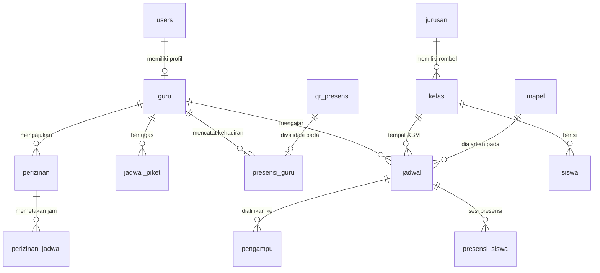

# Sistem Informasi Digitalisasi Presensi Guru & Siswa
### SMKS Mulia Buana — Parungpanjang, Bogor
**Program Pengabdian Kepada Masyarakat (PKM)**  
*Program Studi Teknik Informatika, Fakultas Ilmu Komputer, Universitas Pamulang*

---

## 📌 Ringkasan Eksekutif

**Sistem Informasi Digitalisasi Presensi Guru dan Siswa** adalah platform web terpadu yang dirancang untuk mentransformasi sistem pencatatan kehadiran konvensional (berbasis kertas/manual) menjadi ekosistem digital yang cepat, akurat, transparan, dan aman.

Sistem ini dirancang khusus untuk memenuhi kebutuhan nyata institusi sekolah kejuruan, khususnya di **SMKS Mulia Buana**, dengan karakteristik utama:
1. **100% Offline-Ready (Local Area Network / Wi-Fi Lokal)**: Berjalan mandiri tanpa ketergantungan pada koneksi internet luar atau kuota data seluler.
2. **Dynamic Anti-Fraud QR Code**: Layar server menampilkan QR Code dinamis sekali pakai (*single-use*) yang otomatis kedaluwarsa dalam 10 menit untuk mencegah kecurangan dan penitipan absen.
3. **Konfirmasi Audio-Haptik**: Respons instan berupa nada *beep* frekuensi ganda (*two-tone scanner chime*) dan getaran (*haptic vibration*) saat QR berhasil dibaca kamera HP guru.
4. **Alur KBM & Presensi Siswa**: Terintegrasi langsung dengan jadwal mengajar guru per rombel dan penanganan jam kosong oleh Guru Piket.
5. **Cetak Laporan Resmi**: Dilengkapi generator laporan rekapitulasi kehadiran berkop surat resmi sekolah SMKS Mulia Buana dengan tanda tangan Kepala Sekolah & Admin TU.
6. **100% SVG Vector UI**: Tampilan antarmuka profesional, bersih, dan konsisten tanpa simbol emoji yang tidak formal.

---

## 🏗️ Arsitektur & Teknologi

| Komponen | Spesifikasi / Teknologi | Catatan Implementasi |
|---|---|---|
| **Bahasa Pemrograman** | PHP 8.1+ (Native Prosedural Terstruktur) | Performa tinggi, dependensi minimal, mudah di-hosting lokal |
| **Basis Data** | MySQL / MariaDB (InnoDB Engine) | Mendukung transaksi ACID & *Row-level locking* (`SELECT ... FOR UPDATE`) |
| **Koneksi Database** | PHP Data Objects (PDO) | *Prepared statements* penuh, proteksi 100% dari SQL Injection |
| **Frontend UI/UX** | HTML5, CSS3 Modern, Vanilla JavaScript | Desain responsif (*mobile-first*), 100% SVG Icons, tanpa framework CSS berat |
| **QR Code Engine** | `qrcode.min.js` (Lokal) & `html5-qrcode.min.js` (Lokal) | Disimpan di `assets/js/` agar bekerja penuh saat internet offline |
| **Audio & Haptic API** | Web Audio API (Oscillator) & Vibration API | Sintesis suara murni tanpa file mp3 eksternal |
| **Keamanan Autentikasi** | `password_hash()` BCRYPT, Session Regeneration | Proteksi terhadap *session hijacking* dan *brute force* |

---

## 👥 Hak Akses Pengguna (Role-Based Access Control)

Aplikasi memiliki **3 level hak akses (*Role*)** utama dengan batasan wewenang ketat:

### 1. Admin TU (Tata Usaha)
- Mengelola master data sekolah: Guru, Siswa, Kelas, Jurusan, Mata Pelajaran, dan Jadwal Mengajar.
- Mengatur penugasan Guru Piket harian.
- Mengelola akun pengguna (*Users Management*) terpusat.
- Memproses verifikasi dan persetujuan (*approval*) surat perizinan guru (Sakit/Izin/Dinas).
- Memantau audit perubahan data (*Audit Trail Log*).
- Menghasilkan rekapitulasi kehadiran guru & siswa, ekspor ke file Excel/CSV, dan mencetak laporan resmi bertanda tangan.

### 2. Guru (Pengajar & Guru Piket)
- **Presensi Harian Mandiri**: Melakukan scan QR Code pada layar monitor sekolah menggunakan kamera HP (Presensi Datang & Presensi Pulang).
- **Presensi KBM Siswa**: Mencatat kehadiran siswa (Hadir, Sakit, Izin, Alfa) sesuai jadwal mengajar aktif di kelas.
- **Pengajuan Izin**: Mengajukan permohonan izin/sakit secara digital lengkap dengan unggahan bukti berkas surat dokter/dinas.
- **Operasional Guru Piket**: Mengakses *Dashboard Piket* untuk memantau kelas kosong dan mengambil alih KBM guru yang berhalangan (*delegasi pengampu*).
- **Riwayat & Notifikasi**: Memantau riwayat presensi pribadi dan menerima notifikasi *real-time*.

### 3. Kepala Sekolah (Kepsek)
- **Pemantauan Eksekutif**: Memantau statistik kehadiran guru dan siswa secara *real-time*.
- **Monitoring KBM**: Melihat status pelaksanaan kelas dan guru yang sedang bertugas.
- **Monitoring Izin**: Meninjau status dan riwayat perizinan seluruh staf pengajar.
- **Laporan & Rekap**: Mengakses rekapitulasi presensi bulanan dan mencetak laporan resmi untuk arsip dinas/yayasan.

---

## 📂 Struktur Direktori Proyek

```text
absensi-pkm/
├── index.php                      # Gerbang pengarah utama (routing login/dashboard)
├── login.php                      # Halaman antarmuka login (responsif desktop & HP)
├── logout.php                     # Pemutus sesi aman dan redirect ke login
├── generate-password.php          # Utilitas pengembang untuk membuat hash Bcrypt
├── .htaccess                      # Pengaturan Apache web server & penulisan URL
│
├── config/                        # Konfigurasi Inti Aplikasi
│   ├── database.php               # Koneksi PDO singleton & penanganan error basis data
│   ├── helpers.php                # Helper global: sanitasi e(), appIcon() SVG, alert, format waktu
│   └── session.php                # Session guard: requireLogin(), requireRole(), requireAnyRole()
│
├── admintu/                       # Modul Antarmuka Admin Tata Usaha
│   ├── dashboard.php              # Statistik sekolah, ringkasan KBM, dan aksi cepat
│   ├── guru.php                   # CRUD master data guru sekolah
│   ├── siswa.php                  # CRUD master data siswa per kelas
│   ├── kelas.php                  # CRUD data rombongan belajar (rombel)
│   ├── jurusan.php                # CRUD program keahlian SMK
│   ├── mapel.php                  # CRUD daftar mata pelajaran kurikulum
│   ├── jadwal.php                 # Alokasi jadwal KBM mingguan guru & kelas
│   ├── jadwal-piket.php           # Penjadwalan piket harian guru
│   ├── perizinan.php              # Verifikasi & persetujuan berkas izin guru
│   ├── rekap.php                  # Tabel rekapitulasi kehadiran bulanan
│   ├── rekap-detail.php           # Rincian log harian kehadiran per individu guru
│   ├── cetak-rekap.php            # Cetak laporan resmi berkop sekolah SMKS Mulia Buana
│   ├── users.php                  # Manajemen akun terpusat (Admin, Guru, Kepsek)
│   ├── import.php                 # Fasilitas import data massal via Excel/CSV
│   ├── export.php                 # Ekspor data sekolah ke format CSV/Excel
│   └── partials/                  # Komponen UI: sidebar, topbar, badge notifikasi
│
├── guru/                          # Modul Antarmuka Guru Pengajar
│   ├── dashboard.php              # Beranda guru, status presensi hari ini, jadwal KBM aktif
│   ├── dashboard_piket.php        # Panel kerja guru piket & pengambilalihan kelas kosong
│   ├── presensi.php               # Pemindai QR kamera HP dengan audio beep & getaran
│   ├── presensi-siswa.php         # Formulir presensi siswa per jam KBM
│   ├── riwayat.php                # Log kehadiran pribadi & filter rentang tanggal
│   ├── perizinan.php              # Formulir pengajuan izin & unggah surat bukti
│   ├── notifikasi.php             # Pusat pemberitahuan sistem untuk guru
│   ├── profil.php                 # Informasi akun & pengaturan sandi guru
│   └── partials/                  # Komponen UI guru: sidebar, topbar, notif badge
│
├── kepsek/                        # Modul Antarmuka Kepala Sekolah
│   ├── dashboard.php              # Ringkasan eksekutif kehadiran & ketercapaian KBM
│   ├── monitoring-guru.php        # Pemantau status kehadiran seluruh dewan guru hari ini
│   ├── monitoring-siswa.php       # Pemantau kehadiran siswa per kelas/jurusan
│   ├── perizinan.php              # Rekap perizinan guru yang disetujui/ditolak
│   ├── rekap.php                  # Laporan rekapitulasi presensi bulanan sekolah
│   ├── cetak-rekap.php            # Cetak laporan resmi bertanda tangan
│   └── partials/                  # Komponen UI kepsek: sidebar, topbar
│
├── proses/                        # Modul Pemrosesan Logika Bisnis & Transaksi Database
│   ├── login.php                  # Autentikasi sandi Bcrypt & inisialisasi sesi peran
│   ├── presensi-guru.php          # Validasi waktu masuk/pulang & pencatatan kehadiran guru
│   ├── presensi-siswa.php         # Penyimpanan kehadiran siswa kelas & validasi jam
│   ├── edit-presensi.php          # Koreksi manual presensi siswa + pencatatan audit trail
│   ├── perizinan.php              # Pemrosesan upload berkas & simpan permohonan izin
│   ├── approval-izin.php          # Aksi terima/tolak izin & auto-inject status presensi
│   ├── jadwal.php                 # Transaksi CRUD jadwal pelajaran
│   ├── jadwal-piket.php           # Transaksi penetapan guru piket
│   ├── pengampu.php               # Delegasi guru pengganti pada sesi kelas kosong
│   ├── cetak-rekap.php            # Template HTML cetak resmi dengan kop surat & TTD
│   ├── export-rekap.php           # Generator file ekspor rekapitulasi
│   ├── export-riwayat.php         # Generator file ekspor riwayat guru
│   ├── notif-count.php            # Endpoint polling jumlah notifikasi belum dibaca
│   └── baca-notifikasi.php        # Pembaruan status baca notifikasi
│
├── qr/                            # Modul Sistem Display & Validasi Dynamic QR Code
│   ├── display.php                # Layar monitor sekolah: jam digital, kiosk mode, auto-refresh
│   ├── generate.php               # Generator token dinamis unik (SHA-256) berlaku 10 menit
│   ├── scan.php                   # Endpoint penerima hasil scan dari kamera HP guru
│   ├── status.php                 # Polling status penggunaan QR oleh monitor display
│   ├── test-camera.php            # Halaman diagnostik kesiapan kamera pada HP guru
│   └── start-display.bat          # Skrip peluncur otomatis layar display di Windows
│
├── assets/                        # Sumber Daya Statis (100% Offline)
│   ├── css/style.css              # Seluruh aturan desain, tema warna, layout, dan responsivitas
│   ├── js/                        # Pustaka skrip frontend
│   │   ├── main.js                # Logika interaksi umum, modal, dropdown, dan konfirmasi
│   │   ├── qrcode.min.js          # Generator grafis QR Code offline
│   │   └── html5-qrcode.min.js    # Mesin pembaca kamera barcode/QR offline
│   └── img/                       # Aset logo sekolah dan ilustrasi pendukung
│
├── database/                      # Skrip Skema Basis Data
│   └── absensi_pkm.sql            # Dump basis data MariaDB lengkap dengan relasi dan data awal
│
└── uploads/                       # Direktori Berkas Dinamis
    └── perizinan/                 # Penyimpanan file bukti surat izin (PDF/JPG/PNG) guru
```

---

## 💾 Struktur Basis Data (16 Tabel Relasional)

Database `absensi_pkm` dirancang dengan arsitektur relasional yang dinormalisasi pada engine InnoDB:



1. **`users`**: Kredensial login, peran pengguna (`adminTu`, `guru`, `kepsek`), status akun aktif/nonaktif.
2. **`guru`**: Data kepegawaian guru (NIP, Nama Lengkap, Gelar, Mapel Pokok).
3. **`siswa`**: Data induk siswa (NIS, Nama, Kelas, Jenis Kelamin, Status).
4. **`jurusan`**: Program kompetensi keahlian SMK (misal: TKJ, RPL, MP).
5. **`kelas`**: Rombongan belajar tingkat X, XI, XII.
6. **`mapel`**: Mata pelajaran kurikulum nasional & kejuruan.
7. **`jadwal`**: Penjadwalan mata pelajaran per hari, kelas, guru, dan rentang jam KBM.
8. **`jadwal_piket`**: Penugasan guru piket harian untuk monitoring operasional sekolah.
9. **`presensi_guru`**: Log kehadiran harian guru (waktu masuk, waktu pulang, status Hadir/Izin/Alfa).
10. **`qr_presensi`**: Token QR Code sementara (masa aktif 10 menit, status `sudah_dipakai`).
11. **`presensi_siswa`**: Kehadiran siswa pada setiap sesi KBM (Hadir, Sakit, Izin, Alfa).
12. **`perizinan`**: Surat permohonan izin guru, tanggal mulai/selesai, bukti surat, status *Pending/Disetujui/Ditolak*.
13. **`perizinan_jadwal`**: Jam-jam mengajar yang terdampak oleh izin guru.
14. **`pengampu`**: Pengalihan jam KBM kosong kepada guru pengganti / guru piket.
15. **`notifikasi`**: Pesan pemberitahuan sistem (pengajuan izin, persetujuan, notifikasi kedatangan).
16. **`audit_trail`**: Pencatatan jejak audit (waktu, pelaku, aksi INSERT/UPDATE/DELETE, data lama, data baru).

---

## 🚀 Panduan Instalasi Cepat

### Prasyarat:
- Komputer / Laptop bersistem operasi Windows, Linux, atau macOS.
- Paket server lokal **XAMPP** (disarankan versi PHP 8.1 atau 8.2).
- Browser modern (Google Chrome, Microsoft Edge, atau Mozilla Firefox).

### Langkah-langkah:
1. **Salin Folder Proyek**:
   Letakkan folder proyek di dalam direktori root web server XAMPP:
   `C:\xampp\htdocs\absensi-pkm\`
2. **Nyalakan Server XAMPP**:
   Buka **XAMPP Control Panel**, lalu tekan tombol **Start** pada modul **Apache** dan **MySQL**.
3. **Impor Basis Data**:
   - Buka browser dan akses phpMyAdmin: `http://localhost/phpmyadmin/`
   - Buat basis data baru dengan nama: `absensi_pkm`
   - Klik tab **Import**, pilih file [`database/absensi_pkm.sql`](file:///c:/xampp/htdocs/absensi-pkm/database/absensi_pkm.sql), lalu klik tombol **Go/Kirim**.
   - *(Seluruh akun pengguna bawaan telah dienkripsi dengan Bcrypt, siap digunakan tanpa perlu seeding ulang).*
4. **Buka Aplikasi**:
   Akses melalui browser: `http://localhost/absensi-pkm/login.php`

---

## 🔑 Akun Bawaan (Default Dummy Accounts)

Format kata sandi akun simulasi: `<username>123`

| Role | Username | Password | Deskripsi Wewenang |
|---|---|---|---|
| **Admin TU** | `admin` | `admin123` | Tata Usaha (Pengelola master data, izin, akun) |
| **Kepala Sekolah** | `kepsek` | `kepsek123` | Eksekutif Monitoring Kehadiran & Laporan |
| **Guru (Pengajar/Piket)** | `budi` | `budi123` | Guru Mapel / Jadwal Piket |
| **Guru** | `siti` | `siti123` | Guru Mapel |
| **Guru** | `andi` | `andi123` | Guru Mapel |
| **Guru** | `dedi` | `dedi123` | Guru Mapel |
| **Guru** | `rina` | `rina123` | Guru Mapel |
| *(dan staf guru lainnya)* | `agus`, `fitri`, `rudi`, `maya`, dll. | `<username>123` | Sesuai data di database |

---

## 🛡️ Standar Keamanan & Keandalan

1. **Eliminasi SQL Injection**: 100% kueri basis data menggunakan PDO *Prepared Statements* dengan penonaktifan emulasi kueri (`PDO::ATTR_EMULATE_PREPARES => false`).
2. **Proteksi Cross-Site Scripting (XSS)**: Semua data dinamis yang ditampilkan ke peramban disanitasi menggunakan helper `e()` (`htmlspecialchars` dengan flag `ENT_QUOTES | ENT_SUBSTITUTE`, UTF-8).
3. **Keamanan Sesi & Role Guard**: Setiap file di dalam modul dilindungi guard ketat (`requireLogin()`, `requireRole()`, `requireAnyRole()`). Bila sesi tidak valid, pengguna diarahkan paksa ke halaman login.
4. **Anti-Concurreny & Race Conditions**: Pemrosesan presensi dan pemakaian token QR menggunakan transaksi database dengan penguncian baris eksplisit (`SELECT ... FOR UPDATE`), sehingga mustahil satu QR digunakan dua kali secara bersamaan.
5. **Anti-Fraud QR Security**:
   - Token dibuat menggunakan string acak berkeamanan tinggi (`bin2hex(random_bytes(32))`).
   - Token memiliki masa berlaku absolut (10 menit) dan sekali pakai (*one-time use*).
   - Validasi alamat IP server lokal dan parameter token diperiksa ketat di sisi server (*server-side enforcement*).

---

## 📄 Hak Cipta & Lisensi

Proyek ini dikembangkan dalam rangka kegiatan **Pengabdian Kepada Masyarakat (PKM)** oleh Tim Dosen dan Mahasiswa:
- **Program Studi**: Teknik Informatika (S1)
- **Fakultas**: Ilmu Komputer
- **Universitas**: Universitas Pamulang (UNPAM), Tangerang Selatan
- **Mitra Sasaran**: SMKS Mulia Buana, Parungpanjang, Kabupaten Bogor

Hak cipta dilindungi undang-undang untuk kepentingan pengembangan pendidikan dan transformasi digital sekolah mitra.
